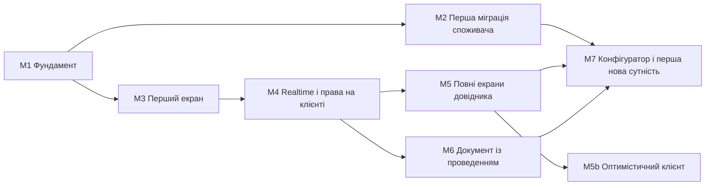

# Дорожня карта Simetra

Віха — це результат, який можна показати; вона закривається, коли виконано її
критерій ([ADR-0090](adr/0090-milestones-are-outcomes.md)). Тут — зміст віх,
їхній порядок і посилання. Статус — лише в GitHub:
[milestones](https://github.com/VSydorenko/Simetra/milestones), issues спек і
блоків, частини системи — мітки. Зміст механізмів задають спеки в
`docs/superpowers/specs/`; якщо тут і в спеці різне — правда в спеці.

## Порядок

М2 іде паралельно з М3: це робота в репо першого споживача, а не в платформі.
М5 і М6 ідуть паралельно. М5b стартує після блоку запису М5 (створення й ТЧ у картці) і далі йде паралельно з ним.
М4 містить ядро синхронізації клієнта: кеш прав клієнта й приймальний тест віхи стоять на ньому ([ADR-0101](adr/0101-sync-kernel-before-other-client-blocks.md)). Блок доказу позицією з тієї самої спеки — у М5b.

## Віхи

| Віха | Результат: що можна показати | Спеки | GitHub |
| --- | --- | --- | --- |
| М1. Фундамент | метадані компілюються в схему БД; наявна база приймається до порожнього плану; права працюють у RLS і командах; довідник пишеться через команди; пакети стоять на npm | [платформна спека](superpowers/specs/2026-09-24-simetra-platform-design.md), [П2](superpowers/specs/2026-09-28-p2-metamodel-compiler-design.md), [промоція](superpowers/specs/2026-10-06-promotion-design.md), [права](superpowers/specs/2026-10-17-rights-design.md), [П4](superpowers/specs/2026-10-26-p4-runtime-design.md) (П4-A), [designer](superpowers/specs/2026-10-02-simetra-designer-design.md) | [milestone](https://github.com/VSydorenko/Simetra/milestone/1) |
| М2. Перша міграція споживача | перша зміна схеми споживача вироблена рушієм і застосована в продакшні: нові об'єкти поруч із прийнятими таблицями, з правами й записом через команди | [платформна спека](superpowers/specs/2026-09-24-simetra-platform-design.md) §12, [П4](superpowers/specs/2026-10-26-p4-runtime-design.md) §9 | [milestone](https://github.com/VSydorenko/Simetra/milestone/2) |
| М3. Перший екран | у шаблоні застосунку на справжній базі відкриваються список і картка довідника: SSR, сесія, редагування шапки | [П4-B](superpowers/specs/2026-11-05-p4-b-client-data-design.md), [П4-D](superpowers/specs/2026-11-08-p4-d-hosts-design.md) (тонкий зріз), [профіль `postgres`](superpowers/specs/2026-11-08-postgres-profile-design.md) | [milestone](https://github.com/VSydorenko/Simetra/milestone/3) |
| М4. Realtime і права на клієнті | зміна в одній вкладці з'являється в іншій під RLS; відкликане право прибирає дані на клієнті | [П4-B](superpowers/specs/2026-11-05-p4-b-client-data-design.md) §8–§9, [ядро синхронізації](superpowers/specs/2026-11-23-t4-sync-kernel-design.md), [профіль `postgres`](superpowers/specs/2026-11-08-postgres-profile-design.md) | [milestone](https://github.com/VSydorenko/Simetra/milestone/4) |
| М5. Повні екрани довідника | довідник повністю ведеться в UI: фільтри, створення, ТЧ, файли, тема візуальної мови, автозбереження без тихого перезапису | [П4-D](superpowers/specs/2026-11-08-p4-d-hosts-design.md), [візуальна мова](superpowers/specs/2026-10-23-visual-language-design.md), [профіль `postgres`](superpowers/specs/2026-11-08-postgres-profile-design.md) | [milestone](https://github.com/VSydorenko/Simetra/milestone/5) |
| М5b. Оптимістичний клієнт | зміна з'являється на екрані без очікування сервера і переживає чужі зміни без відскоку; список тримає межу пам'яті; оракул, бюджети швидкодії й матриця браузерів зелені в CI | [П4-B](superpowers/specs/2026-11-05-p4-b-client-data-design.md) §6–§7, §12, [П4-D](superpowers/specs/2026-11-08-p4-d-hosts-design.md) §8 | [milestone](https://github.com/VSydorenko/Simetra/milestone/8) |
| М6. Документ із проведенням | документ створюється з екрана, проводиться і робить рухи регістрів | [П4](superpowers/specs/2026-10-26-p4-runtime-design.md) (П4-C), [П2](superpowers/specs/2026-09-28-p2-metamodel-compiler-design.md) | [milestone](https://github.com/VSydorenko/Simetra/milestone/6) |
| М7. Конфігуратор і перша нова сутність | сутність, створена в конфігураторі, доходить до продакшну без ручного коду | [П4](superpowers/specs/2026-10-26-p4-runtime-design.md) (П4-E), [платформна спека](superpowers/specs/2026-09-24-simetra-platform-design.md) §10 | [milestone](https://github.com/VSydorenko/Simetra/milestone/7) |

Робота без віхи (беклог) — issues без milestone; велика нова робота в будь-якій
частині системи відкриває нову віху.

Назви підпроєктів П0…П6 — історичні групи спек «першого випуску»
([платформна спека](superpowers/specs/2026-09-24-simetra-platform-design.md)
§12); одиницею статусу вони не є.
